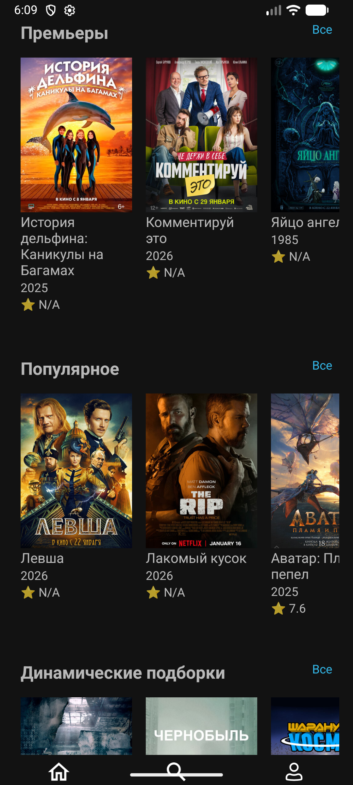
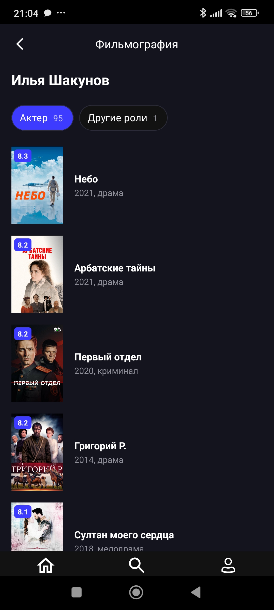
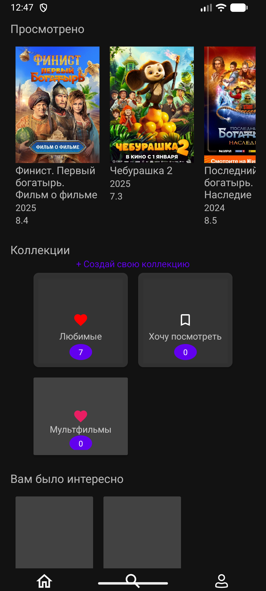
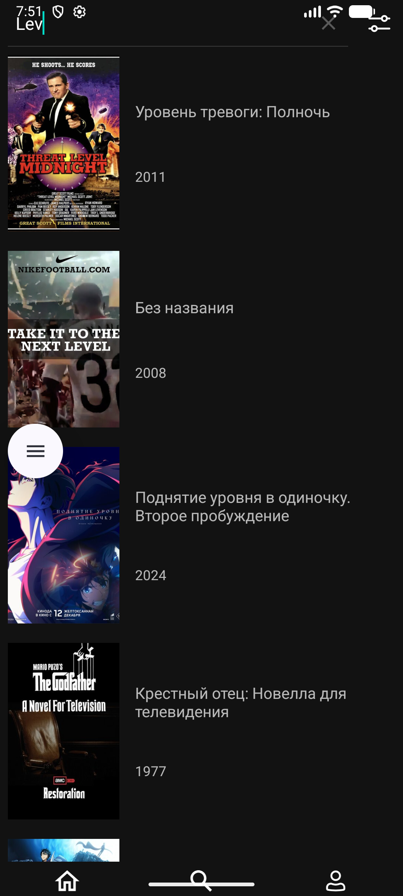

# 🎬 SkillCinema App

Учебное Android-приложение для поиска фильмов и просмотра информации о фильмах и
актёрах. Данные загружаются из
[Kinopoisk API Unofficial](https://kinopoiskapiunofficial.tech/), а пользовательские
списки сохраняются локально на устройстве.

> 📱 Проект выполнен в рамках курса **«Android-разработчик. Уровень 1» от Skillbox**.

---

## 🚀  Возможности

- стартовый онбординг;
- подборки на главном экране: премьеры, популярные фильмы, топ-250, сериалы и
  фильмы по жанру и стране;
- поиск по названию и фильтрация по типу, стране, жанру, рейтингу, году и
  сортировке;
- карточка фильма с описанием, рейтингом, актёрским составом, съёмочной группой,
  сезонами (для сериалов), похожими фильмами и галереей изображений;
- карточка актёра, популярные работы и фильмография по профессиям;
- локальные списки «Любимые», «Хочу посмотреть» и «Просмотрено»;
- история просмотра и пользовательские коллекции.
> Для сетевых разделов нужны подключение к интернету и доступный API-ключ.
> Работоспособность и набор данных зависят от ограничений внешнего API.

---

## 🛠 ИТехнологии и устройство проекта

- **Kotlin**, корутины и `StateFlow`/`SharedFlow`;
- интерфейс на **Fragments + XML layouts**, View Binding, RecyclerView и Material
  Components;
- **MVVM**, репозитории и use case-классы; зависимости создаются вручную в классе
  `Application` (Dagger/Hilt в приложении не используется);
- **Jetpack Navigation** и Safe Args;
- **Retrofit**, OkHttp и Gson для работы с REST API;
- **Room** (поверх SQLite) и SharedPreferences для локальных данных;
- **Glide** и Picasso для загрузки изображений;
- **Firebase Analytics** и **Crashlytics**;
- Google Mobile Ads SDK.

Проект состоит из одного Gradle-модуля `app`. Минимальная поддерживаемая версия —
Android 7.0 (API 24), `targetSdk` — 35, `compileSdk` — 36.
---

## 🖼️ Скриншоты

### Основные экраны

| Главный экран | Фильмы раздела | Карточка фильма | Список актёров | Съёмочная группа |
|---|---|---|---|---|
|  |  | <br> |  |  |

### Фильмы, актёры и профиль

| Галерея | Страница актёра | Фильмография | Профиль | Коллекция «Любимые» |
|---|---|---|---|---|
|  |  |  |  |  |

### Поиск

| Экран поиска | Фильтры поиска |
|---|---|
|  |  |

## Требования

- Android Studio с поддержкой Android Gradle Plugin 8.13.2;
- JDK 17;
- Android SDK Platform 36;
- устройство или эмулятор с Android 7.0 (API 24) и выше;
- подключение к интернету для загрузки данных и Gradle-зависимостей.
---

## ⚙️ Установка

1. Клонируйте репозиторий:

   ```bash
   git clone https://github.com/Aleks-Mark-Dzr/final_android_lvl1.git
   cd final_android_lvl1
   ```

2. Откройте проект в Android Studio и дождитесь завершения Gradle Sync.
3. Установите Android SDK Platform 36, если Android Studio предложит это сделать.
4. Запустите конфигурацию `app` на эмуляторе или подключённом устройстве.

Для проверки сборки из командной строки используйте:

```bash
./gradlew assembleDebug
```

В репозитории находится конфигурация Firebase для учебного приложения. Для
собственной публикации следует создать проект Firebase, заменить
`app/google-services.json` и использовать собственные ключи и идентификаторы
сервисов.
